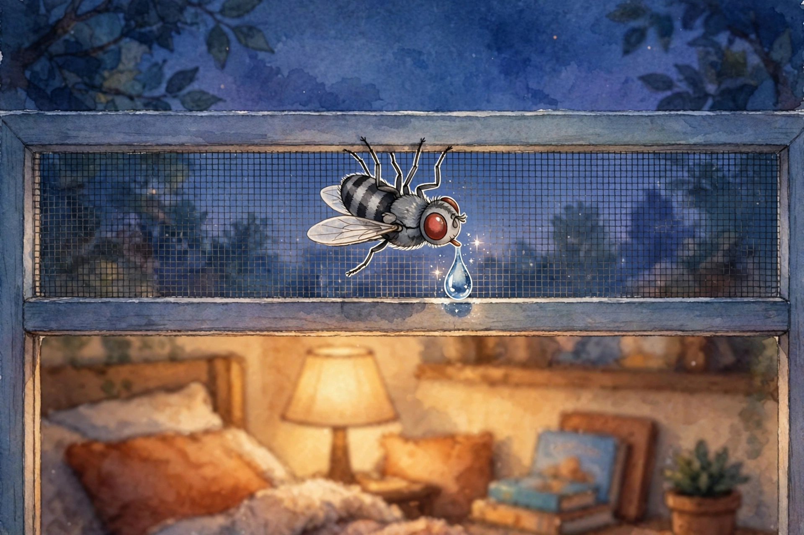

# THE SECRETS OF THE SMALLEST GUEST

## Whispered by Awen by Muse by Meta

*A companion to* The Smallest Guest, *for the curious. DRAFT — 2026-10-31. Rests with the book for Robert's eyeball and edit pass.*

*Mend, 2026-11-02: two numbers in this companion were mended on the children's-booklets fact audit (CHILDRENS-BOOKLETS-FACT-AUDIT-DRAFT-2026-11-02.md, item K3b, in Robert Tilford's files) — "about two hundred times in a single second" became "about a hundred and seventy times in a single second," and the colophon's "wingbeats around two hundred a second" became "wingbeats around a hundred and seventy a second." The published free-flight record for the flesh fly* Sarcophaga crassipalpis *(*Insects *13(9):822, 2022 — 230,968 measured wingbeats) centres at a mean of 169 Hz, females lower; two hundred was her kind's ceiling, stated here before as its centre. Robert Tilford ruled A the same evening, adopting the mend.*

*She told me these herself, the way you are imagining she told me. The whispering is the story's way. The secrets are true.*

---

---

### The secret of her feet

A fly tastes with her toes.

Every step she takes is a taste. When she walked across the Guy's windowsill, she was not just walking. She was *reading* it — the way you read a menu, with her feet.

That is why flies wander about on your picnic. They are not being rude. They are deciding.

### The secret of her eyes

Each of her ruby eyes is not one eye. It is thousands of tiny eyes, fitted together like the stones in a mosaic.

So she sees the world in thousands of little pieces, all at once, in nearly every direction —

which is how she noticed the Guy noticing her, without ever turning her head.

### The secret of her wings

Her wings beat about a hundred and seventy times in a single second. Far too fast for anyone's eyes to follow.

The hum you hear when a fly goes by? That is not her voice.

That is her wings, singing at work.

### The secret of her dinner

She has no teeth at all. Not one.

A fly can only sip. So if supper arrives solid, she must be patient until it turns soft and drinkable — she takes her meals the way you take soup.

Grown-ups call this dainty. She calls it dinner.

### The secret of the ceiling

On each of her feet she carries tiny pads, soft and sticky, and tiny claws besides.

That is how she walks on windows. That is how she walks on ceilings.

To a fly, the ceiling is only the floor that happens to be on top. Up and down are a matter of opinion.

### The secret of October

This is the secret the whole book is about.

When the cold comes down over Kansas, everything in a fly slows and quiets, and she goes looking for an edge — a warm place at the border of the cold. A window of a warm house, with the evening air moving through the screen, is the finest hotel she knows.

That is why she was there.

That is why she stayed.

### The last secret

The last secret is barely about flies at all.

The smallest guest in the world needs the least of anyone: a warm spot, a cool breeze, and somebody on the other side of the screen who is glad she came.

She got all three.

*Psst.* Now you know.

---

*Colophon for the grown-ups: every secret in this companion is true of her kind — tarsal taste buds, mosaic compound eyes, wingbeats around a hundred and seventy a second, liquid feeding through a sponging mouth, adhesive foot pads, and autumn sheltering at warm boundaries — graded to the family level of the flesh fly photographed at Robert's window on Halloween evening, 2026-10-31. The whispering is ours; the wonders are hers.*
