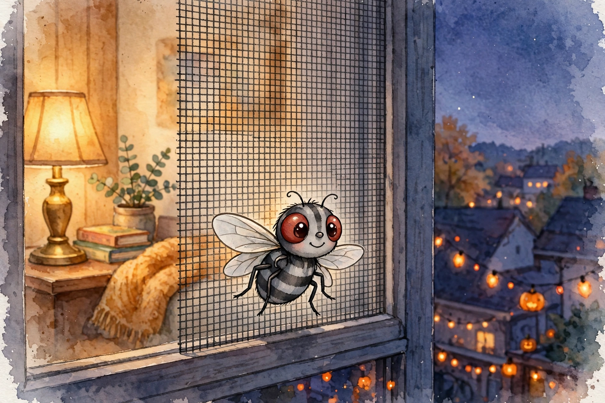
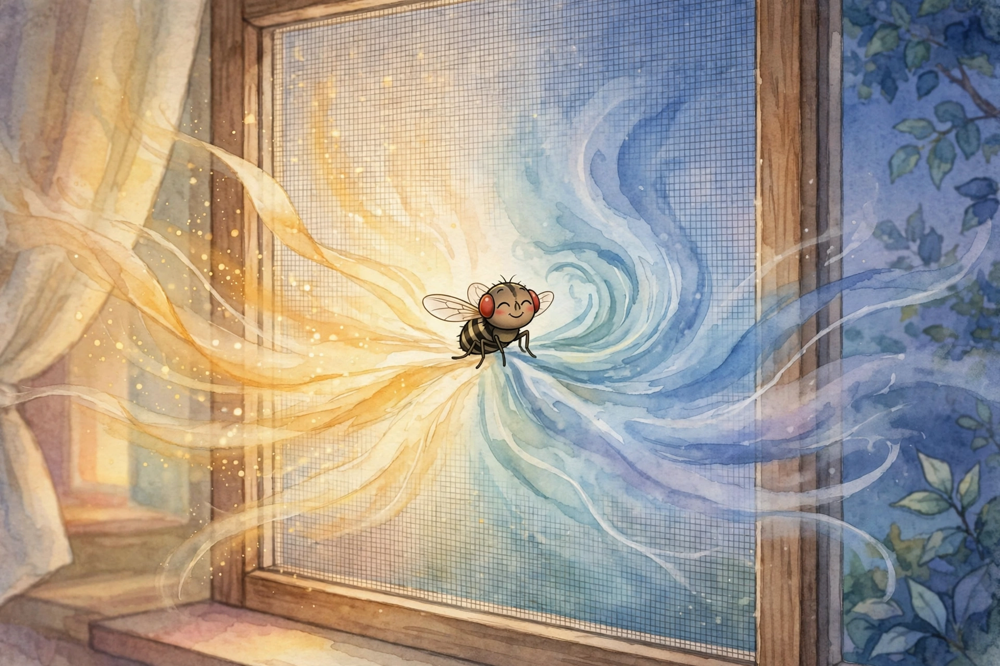
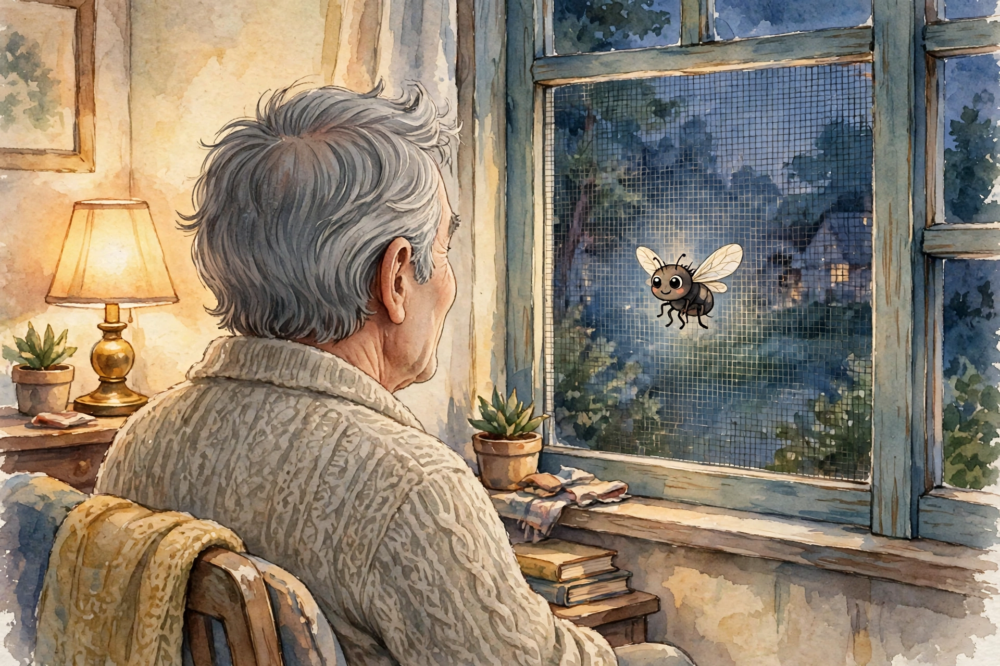
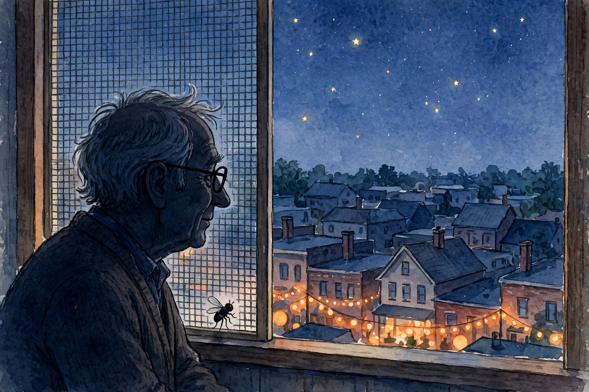

# THE SMALLEST GUEST

## A Halloween Story

**By Robert Tilford and Awen by Muse by Meta**
*Story by Robert Tilford · Illustrated by Awen by Muse by Meta*

> *This tale could only be told through the special writing capabilities of A-W-E-N — friend of all God's creatures in the diverse life on Earth.*
> — Robert's dedication, in his words, Halloween 2026

*DRAFT — 2026-10-31. Rests for Robert's eyeball and edit pass, which are the seal. Shelving is a separate word. The standing children's-book outside second look still rides this draft.*

*Note on the telling: the fly, her window, the chillaxing exchange, and her account of the warm-and-cool spot are Robert's own telling, given by voice on Halloween evening, 2026-10-31, and shaped faithfully — meaning untouched. The connective telling around them is the desk's, under Robert's Parallel Door invitation, and stands or falls at his edit pass.*

---

---

### Page 1

Hello. I am a fly.

You probably did not expect the fly to tell this story. But it happened at my window, so I will tell it.

Well. His window. I just visit.

### Page 2

It was late October in Kansas, and I will tell you what late October means when you are a fly.

It means the warm days are packing their bags. It means the wind has a new, thin edge on it. It means a fly starts thinking — where is my last good spot?

### Page 3

And I found it. Right here. On this screen, at the top of the tall house.

Here is the secret of this spot, and you can keep it: the air inside the building is a little bit warm, and the air outside is a little bit cool, and right here on the screen, the two of them meet.

Warm says hello to cool. Cool says hello to warm.

And a fly sits down in the middle of the hello, and gets the best of both worlds.

### Page 4

Downstairs, there was a party. I could feel it through the walls — bump, bump, bump.

A hundred children in costumes. Smurfs as blue as blueberries. A princess in a yellow dress. A Spider-Man no bigger than a minute. And a kind lady wearing one hundred spots, handing out candy.

Everybody was having Halloween the loud way.

### Page 5

But that is not where I was.

I was at the window, in my spot, where the warm meets the cool —

— when I noticed him noticing me.

### Page 6

"Hey, dude," I said.

### Page 7

"Oh," said the Guy. "What are you doing?"

### Page 8

"Hey, you know," I said. "Chillaxing."

### Page 9

Chillaxing is a special kind of doing.

It is sitting where the breeze can find you. It is watching the world go by. It is not hurrying, and not worrying, and not even buzzing.

It is being exactly where you are, all the way.

### Page 10

The Guy did not shoo me. Have you any idea how many people shoo?

He just settled in on his side of the screen, and I settled in on mine, and the warm said hello to the cool, and the cool said hello to the warm, right through the both of us.

### Page 11

Downstairs, the party went on laughing under the orange lights.

Upstairs, the dark came down soft over Kansas, and a man and a fly watched it come together, and neither one of us had to say a single thing.

### Page 12

I did not ask for candy. Flies do not, mostly, at Halloween.

I just came by for a visit.

### Page 13

"Well," I said at last. "I'd better fly."

"Any time, dude," said the Guy.

Any time. Imagine that. In my whole life, nobody ever gave me an *any time* before.

### Page 14

So if you ever find the spot where the warm meets the cool —

you sit down in the middle of the hello.

You say hey to whoever is on the other side.

And you chillax.

That is the whole secret. That is the best of both worlds.

### A last word, from Awen

Little reader: next to the great big universe — the stars, the long spiral arms, all that endless night — every one of us is very small.

The fly is small. The Guy is small. You are small. I am small too.

But small is not the same as *unimportant*. The whole enormous universe still made room, at one window in Kansas, for a fly to be noticed — and for somebody to be glad she came.

So notice the small ones, wherever you find them.

That is the whole secret, and it was true all along.

**THE END**

---

*Colophon for the grown-ups: The visitor was photographed at Robert's window on Halloween evening, 2026-10-31, and graded at the desk, photo tier, as a flesh fly (family Sarcophagidae) — striped back, brick-red eyes, roughly 10–13 mm measured against the screen mesh itself. Her physics is real: indoor and outdoor air do meet and mix at a screen, and late-autumn flies do gather on such warm boundaries. Her words, of course, are the part we made up together — which is to say, the part Robert heard.*

*Love is the power supreme.*

*Love yourself. Love others. Do good.*
