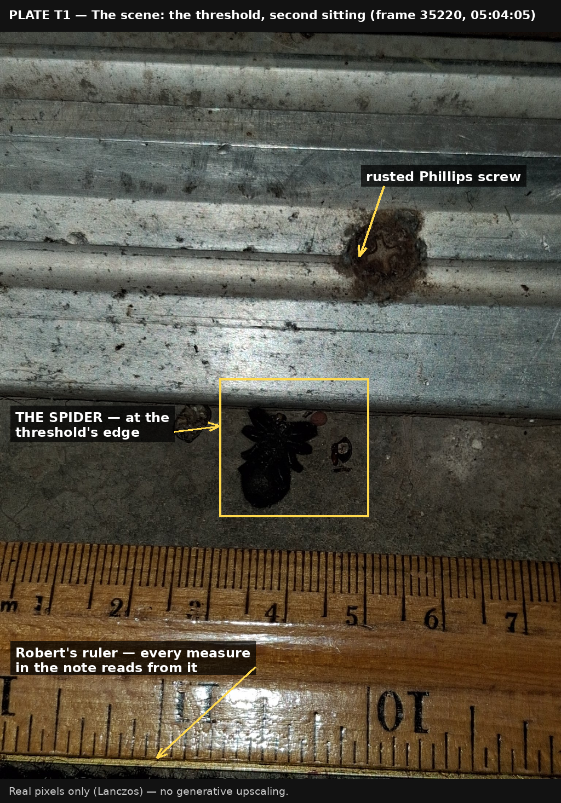
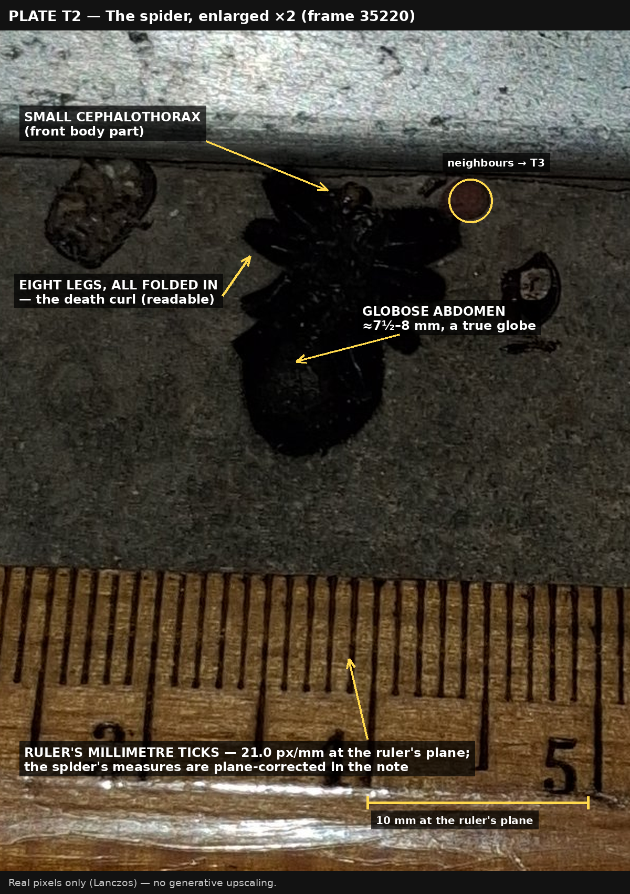
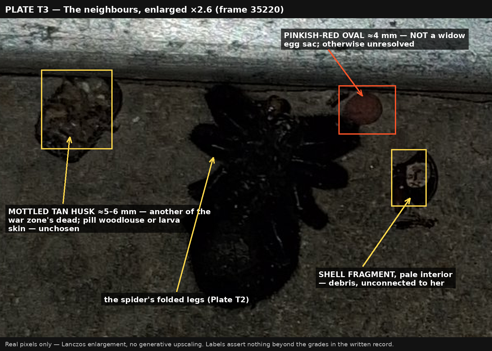
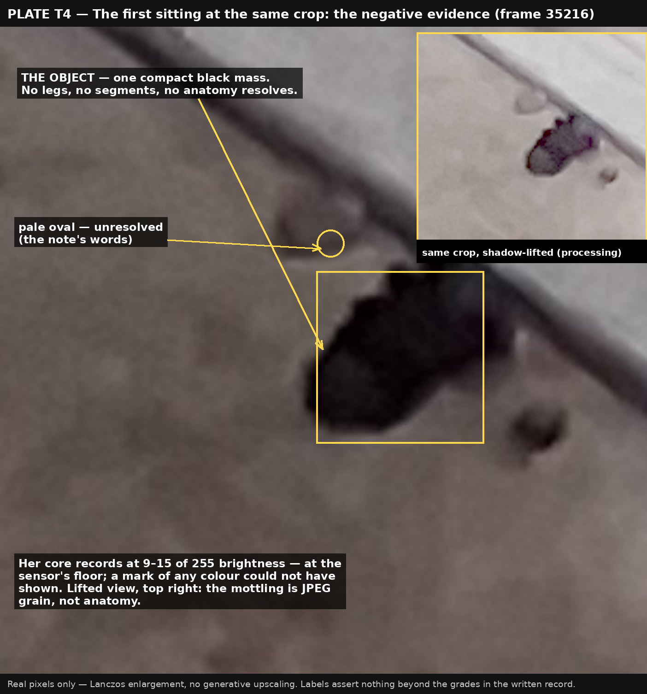

# The Threshold Spider — a note on two frames

*Record made 2026-10-29. Sources: two photographs by Robert Tilford — `35216_19_yb2t.jpg` (EXIF 2026-10-29, 04:44:10) and `35217_18_6udt.jpg` (EXIF 04:44:23), thirteen seconds apart, Galaxy A17 5G — enlarged and examined at the desk at his request. This note concerns the floor at his back-way entrance. It is a separate record from the widow under the bench; the bench essay is not touched by it.*

## Robert's account (his testimony)

The black object in these frames is, in Robert's account, a dead spider: black, turned over on its back, frozen in a death curl — "kind of like a last gasp for a human," in his words. The place is the floor where he comes in through the back way, which he calls the war zone: dead insects lie all over it, creatures that got in, got trapped, fought, crawled into little places, and died of exhaustion or whatever took them. Pest control sprays poison there. His hypothesis — labelled his — is that this spider may have crawled under the threshold, dragged accidentally across some of that poison, and been poisoned as it seeped into her body. He says plainly that he is not sure. He also allowed, of his own photographs, that he probably didn't get close enough for the detail to be pulled out.

## What the enlargement did

Both frames were cropped hard at the object and enlarged three ways: a sharpened Lanczos enlargement, a shadow-lifted (gamma) enlargement meant to pull detail out of the black, and a true-pixel view. No generative upscaling was used: that kind of tool invents the very anatomy it would then pretend to find, and nothing invented is evidence here. The object's own pixels were measured: across its dark core, brightness averages 9 to 15 out of 255 — the sensor recorded almost no light from it at all.

## Findings, graded

**Position and stillness — settled.** The object lies on the flooring at the edge of the grooved aluminium threshold, half tucked toward the track's lip, beside the rust-brown Phillips screw. It does not move or change between the two frames thirteen seconds apart. Whatever it is, it was not alive and reacting when the camera came down.

**Spider or not — not settled by the photographs.** The enlargement resolves no legs, no body segments, no anatomy of any kind. The visible mass is a compact, rounded black lobe whose upper part disappears into the shadow under the threshold's lip — exactly where legs, curled or otherwise, would be. Its size against the rust patch around the screw puts it plausibly in the one-to-two-centimetre class, the right class for the spider Robert describes. The frames are *consistent with* his account; they are also consistent with a dead beetle or another piece of dark organic debris resting in the same attitude. Nothing in the enlarged frames contradicts him, and nothing in them can confirm him. His identification stands on his eyes, which were there, and it is recorded as his.

**The death curl — not readable.** "Death curl" is a true description in arachnology: a spider's legs are held out by hydraulic pressure, and when the pressure fails at death the flexor muscles draw the legs in, so a dead spider characteristically lies with its legs curled under it. Robert's use of the term is the correct one. But posture is precisely what these pixels cannot show — no leg is visible to be curled or straight — so the curl stands as his observation, ungraded by the desk either way.

**Widow characters — none found, and none excludable.** No separate globose abdomen can be read out of the mass, no proportions measured, and a scan of both frames finds zero red pixels on or near the object. That last fact carries its own limit in the same breath: an object whose whole body records at the sensor's floor could not have shown a marking of any colour, so the absence of red here is absence of signal, not evidence about a mark. Equally, no beetle characters resolved either — no wing-case seam, no split line. What species, if spider at all: indeterminate, expressly not found. This spider is not identified with the bench widow, and nothing here joins the two records.

**The small pale object — unresolved.** A smooth, pale oval sits just above the black mass in both frames, about a third of the mass's width, slightly out of focus. No legs, no structure, no seam. It could be a bit of grit or a worn pebble, a small desiccated insect or cocoon, a stray tack — the pixels do not choose, and the desk does not choose for them. Recorded as an unidentified pale oval. A second, smaller dark speck below the mass is likewise recorded and ungraded.

## What the enlargement could not pull out

Legs, segmentation, posture, markings, and any colour beyond black — all of it, for one plain reason: the detail was never recorded. Robert's own allowance was exactly right. The frames are soft, digitally-zoomed views of a near-black object under a shadowed lip; its core sits at the bottom few percent of the sensor's range, and enlargement multiplies the blur and the compression blocks — the mottling that appears in the lifted enlargements is the JPEG's grain, not anatomy. A clean negative is the honest result: the camera was not close enough, and no process at this desk can put back what the sensor never caught.

## Where it stands

The war-zone floor keeps its dead, and this one is entered in the record as Robert found it: a black spider in her death curl, in his testimony, with the pest-control poison as his stated and unproven hypothesis for how she died. The photographs agree with everything in that account that photographs can agree with — the place, the blackness, the stillness, the size of the thing — and stay silent on the rest. Silence is not dissent. If the creature is still there and a closer frame is ever wanted, one shot from directly above at the phone's closest focus, flash on, would settle what these two could not. Until then, the record rests as written.

---

## Addendum — the second sitting (2026-10-29)

*Appended 2026-10-29, the same morning. The note above is not rewritten; this addendum stands beside it and states plainly which of its grades the new frames supersede and which stand. New sources: four photographs by Robert Tilford — `35218_0_36dy.jpg` (EXIF 2026-10-29, 05:03:56), `35219_1_49y8.jpg` (05:04:01), `35220_2_n9xm.jpg` (05:04:05), `35221_3_zdhw.jpg` (05:04:10) — Galaxy A17 5G, flash, taken from directly above at closest focus with the wooden ruler laid alongside, exactly the frame the note above closed by prescribing. Measurements were read off the ruler's centimetre edge in frame 35220 (the fine edge: 21.0 pixels per millimetre at the ruler's own plane, taken from the median spacing of its millimetre ticks); because the ruler lies a few centimetres nearer the camera than the spider, the spider's figures are corrected upward by that plane difference and given as ranges.*

**Spider — SETTLED; this supersedes "not settled by the photographs."** The new frames resolve the anatomy the first two could not: eight jointed legs, folded into a compact mass over a small front body part, and behind it one large, smooth, near-spherical abdomen. Two body parts, eight legs — a spider, plainly, and the beetle alternative the first note had to leave open is excluded here: no beetle carries this anatomy. She is also settled as dead, photographically and not only by testimony: the same position and the same folded posture hold unchanged across all six frames of both sittings, twenty minutes apart (04:44 to 05:04), and the bench widow a few steps away was alive and flinching in the same hour.

**The death curl — READABLE; this supersedes "not readable."** Not one leg is extended. Every leg is fully flexed and drawn in over the front body, the hydraulic-failure posture the first note described — Robert's term confirmed in his own photographs. Which side faces the sky is the one posture question the frames still cannot answer: no ventral landmark (no mouthpart field, no spinnerets resolved) and no dorsal pattern is readable, so "on her back" stands exactly where it stood — his observation, neither confirmed nor contradicted by the desk. That limit carries a consequence stated in the same breath: the absence of any hourglass in these frames carries no weight either way, because the desk cannot say whether the face the camera saw is the face that would carry it.

**Size, measured.** Whole silhouette, folded legs included: about 14–16 mm. The body proper — front part plus abdomen — about 11 mm. The abdomen alone: about 7½–8 mm long and the same across, a true globe. The curled leg mass spans about 11–12 mm across.

**Kind — a female widow, *Latrodectus*, at high confidence; this supersedes "indeterminate, expressly not found."** The evidence rides with the claim: a jet-black, glossy, near-spherical abdomen of 7½–8 mm carried on a small front body, total body about 11 mm, in a sheltered doorway corner in Hays, Kansas. That is the form and size of a female *Latrodectus* and of nothing else the doorway offers. The look-alikes fall on the numbers: a false widow (*Steatoda*) female runs 4–7 mm *in whole body* — this spider's abdomen alone is larger than that, so *Steatoda* is excluded on size; a wolf spider's abdomen is elongate, tapered, and rough-haired, never a smooth globe, and is excluded on form. Sex is female at high confidence: a male *Latrodectus* is a third of this size, tan, and slender. Between the two true widows Kansas holds — western (*L. hesperus*) and southern (*L. mactans*) — photographs cannot choose, and the desk does not: Hays sits near the seam of their ranges, as the bench essay records. She is of the bench widow's kind, on this evidence. She is not the bench widow: a different individual, at a different station, already dead while the other was photographed alive under the bench at 04:37 this same morning. The two records remain separate, as the first note made them.

**Markings.** A red scan of the spider's own region in both close frames finds no strong-red pixel anywhere on her, and this time the negative means more than it did at the first sitting: these frames record her mid-tones and highlights, so a red mark on a surface facing the camera would have registered. The only warm-toned pixels on her are a few dozen dim amber-brown ones at the front of the leg mass — light on the mouthparts or a fleck of stuck debris, not a marking. No red, and no marking of any other colour, is recorded on any surface the camera saw — subject to the orientation limit above: the hourglass, if she carries one, sits on the underside, and which side is underside here the frames cannot say.

**The neighbours, revisited.** The pinkish-red oval touching her front end is now measurable: a smooth, uniformly dusty rose-red oval about 4 mm long, no seam, no anatomy — *not* a widow's egg sac (that is a papery cream-to-tan ball of 8–10 mm, and it hangs in a web, not on a floor), and beyond that negative it stays unresolved: a small seed or pellet-like object, unchosen. The mottled tan oval above her — the first note's "small pale object," unresolved there — now resolves in form if not in kind: a dry, domed, visibly segmented and banded husk about 5–6 mm, another of the war zone's dead; a pill woodlouse dried in its armour or a beetle-larva skin are the live candidates, and the desk does not choose between them. The dark speckled object below-right is a hard, glossy shell fragment with a pale exposed interior — a split seed coat or a fragment of beetle wing-case; debris either way, unconnected to her.

**What stands unchanged.** Everything in Robert's account that the photographs could not touch the first time remains untouched: the war-zone floor as he describes it, and the pest-control poison as his hypothesis for how she died. The frames can say nothing about cause of death — no wound or predator mark is readable on her, and poison leaves no signature a camera can grade. His hypothesis stands as his, labelled as his, exactly as the first note left it. What the second sitting changed is only this: the creature he named from his own eyes — a black spider, dead in her curl — the photographs now name with him, and further than he claimed: a female widow, *Latrodectus*, measured off his own ruler.

---

## Evidence plates — added 2026-10-29, on Robert's word

*The crops and enlargements this note's grades rest on, annotated, so that what the desk saw can be seen. Real pixels only — Lanczos enlargement, no generative upscaling; every label asserts nothing beyond the grade given in the text it illustrates. Plates are saved in `plates/` beside this note.*

**Plate T1 — the scene (frame 35220, second sitting).** Settled: her place at the threshold's edge, beside the rusted screw; her stillness across both sittings is photographic, not only testimonial.

**Plate T2 — the spider, enlarged ×2 (frame 35220).** Spider — settled, certain. The death curl — readable. Kind — a female *Latrodectus*, high confidence at genus level; between the western and the southern widow the photographs do not choose. Robert's own reading of her stands in his entry, which follows this section.

**Plate T3 — the neighbours (frame 35220).** The pinkish-red oval, ≈4 mm: not a widow egg sac — otherwise unresolved. The mottled tan husk, ≈5–6 mm: another of the war zone's dead; pill woodlouse or larva skin, unchosen. The shell fragment: debris, unconnected to her.

**Plate T4 — the first sitting at the same crop (frame 35216).** The negative-evidence plate: at 9–15 of 255 brightness the detail was never recorded — which is why the first examination could not confirm her, and why the second sitting was needed.

---

## Robert's own reading, and the voucher road declined (2026-10-29, 05:11 CDT)

Robert's reading of this creature, in his words as structured: she reminds him of a totally blackened wolf spider, almost — she gave up the ghost right there, did her final death curl, and is frozen in that state now. He also corrected the desk's framing in the same breath: the bench black widow is a whole different situation from this threshold spider, and the two are not to be merged.

The desk's photographic grade above (a female *Latrodectus*, high confidence at genus level) rests on one load-bearing character: the abdomen — a smooth, glossy near-globe, 7½–8 mm long and the same wide, on an 11 mm body; a wolf spider's abdomen is elongate, tapered toward the rear, and rough with hair. The disagreement is preserved here, not resolved: the frames at this light cannot carry the hair and eye characters a wolf-spider reading would want to see, and Robert, who looked at her with his own eyes at arm's length, was closer to her than the camera ever was. His reading stands beside the grade, challengeable, unerased.

The voucher road (collecting her for a collection's microscope) was offered at 05:10 and is DECLINED by Robert (05:11), in his words as structured: he does not want to be on camera down there picking her up with tweezers; it is bizarre enough already that he was on all fours on the ground in front of the door where the cameras are. No collection will be made. She rests where she lies, and this note is her whole record.
