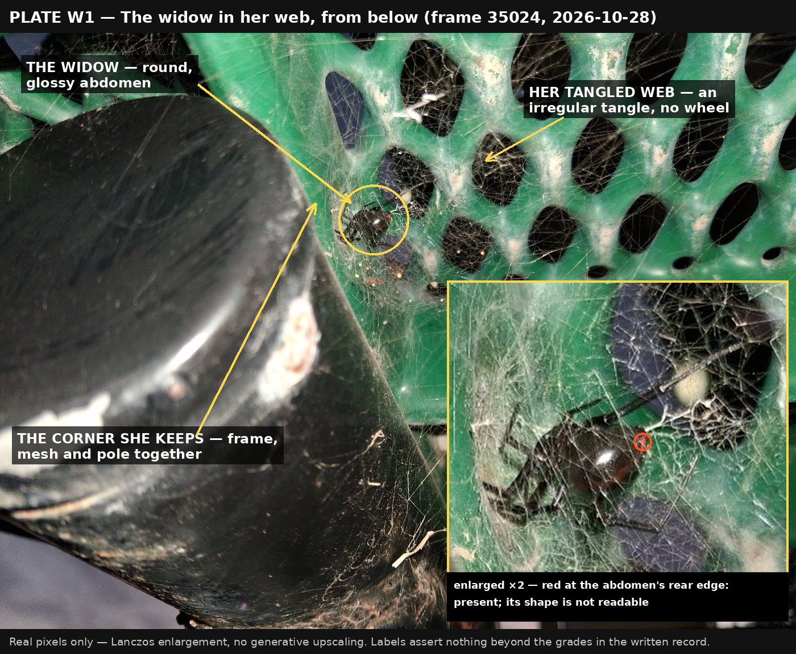
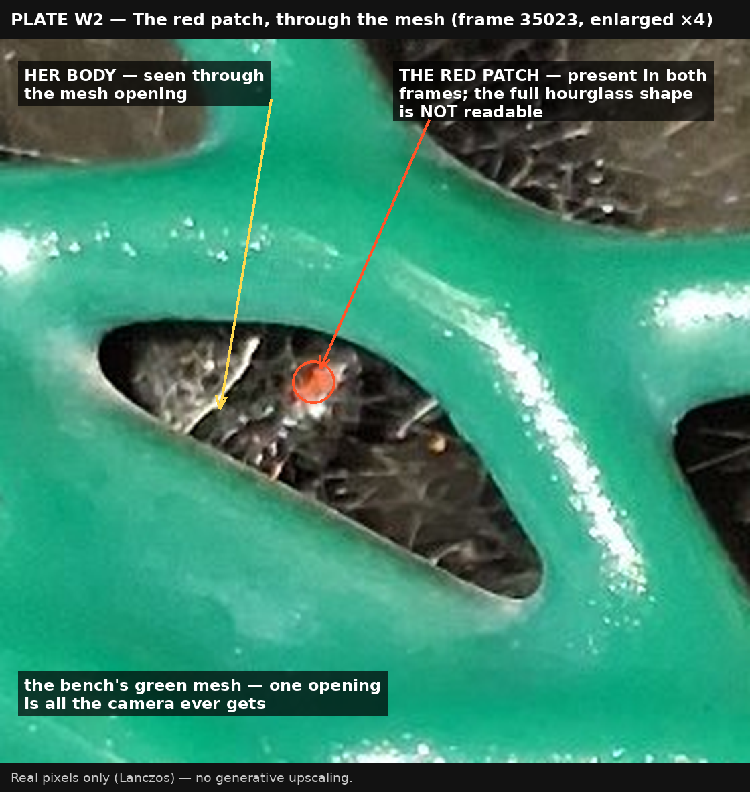
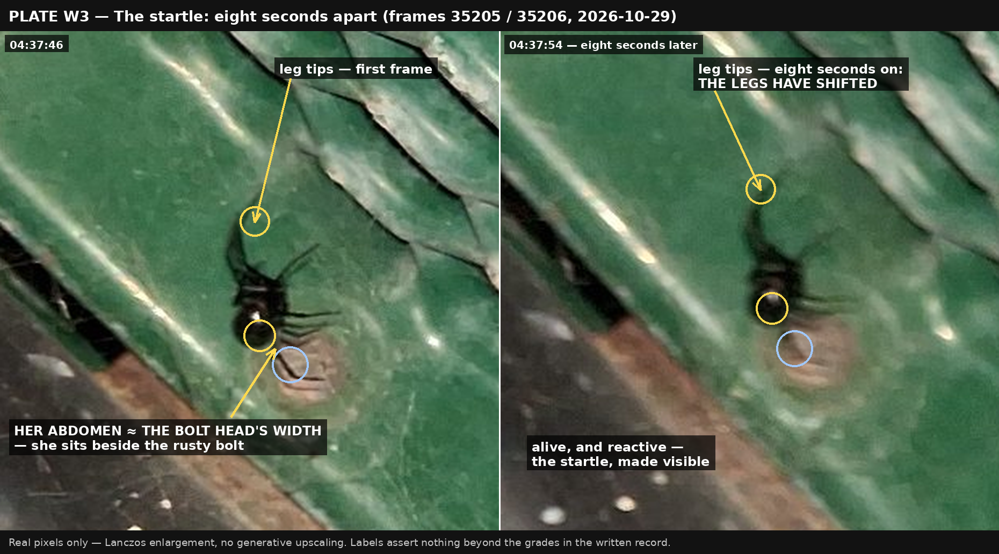
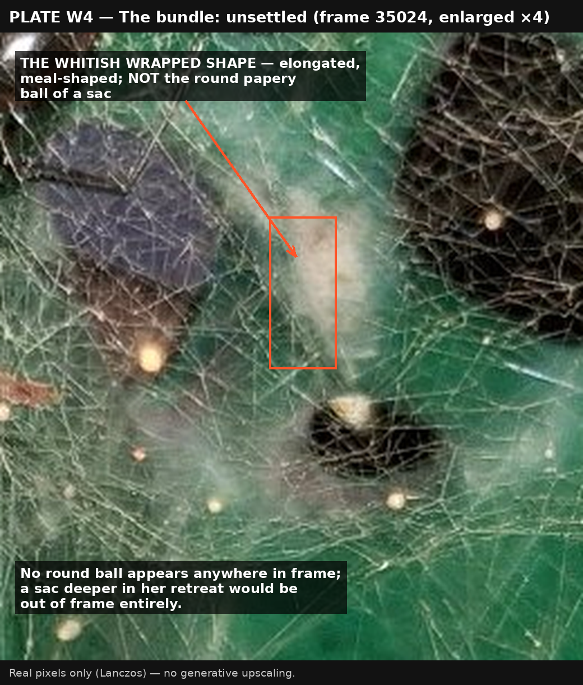

# Evidence Plates — The Widow Under the Bench

*Built 2026-10-29, on Robert Tilford's word, as the companion to the essay "The Widow Under the Bench" (`AWEN-THE-WIDOW-UNDER-THE-BENCH-FINISHED-2026-10-29.md`). These are the crops and enlargements the essay's grades rest on, annotated — so that what the desk saw can be seen. Real pixels only: Lanczos enlargement, no generative upscaling, which invents the very anatomy it would then pretend to find. Every caption asserts nothing beyond the grade on the essay's record. Plates are saved in `plates/` beside this file.*

---

## Plate W1 — The widow in her web, from below (frame 35024, 2026-10-28)

She hangs in her tangled web at the corner she keeps, where the bench's frame, mesh and pole meet. The kind is certain — a widow, in a widow's web, in a widow's form; the species is almost certainly the western widow, *Latrodectus hesperus*, and the "almost" stands, Hays lying near the seam of two widows' country. The inset (enlarged ×2, real pixels) shows the red at the rear edge of her abdomen: present; its shape is not readable.

## Plate W2 — The red patch, through the mesh (frame 35023, enlarged ×4)

The red patch is present — here, small and vivid through one opening of the bench's green mesh, and again at the rear edge of the abdomen in frame 35024 (Plate W1's inset). A patch is all that ever shows: no frame holds her whole underside, so whether the famous hourglass stands complete or broken, nobody can read from these pictures. The patch is enough for the kind, not enough for a portrait.

## Plate W3 — The startle: eight seconds apart (frames 35205 / 35206, 2026-10-29)

The second morning: 04:37:46 and 04:37:54, eight seconds apart. She is not in her web but out on the flat green frame of the bench, beside the small rusty bolt head; her abdomen is about the width of the bolt head she sits beside. Between the first frame and the second, her legs have shifted — she is alive, and reactive: the startle Robert described, made visible. That she is the same widow as the bench's stands at the grade of consistency, not proof: the same bench corner, the same form. No red shows in either frame, nor should it — the camera saw her back, and the mark lives on her underside.

## Plate W4 — The bundle: unsettled (frame 35024, enlarged ×4)

Unsettled, in both directions. The only whitish wrapped shape in frame is elongated — the shape of a wrapped meal more than of the smooth, round, papery ball her kind makes for a sac — and the desk's reading leans meal-ward; no round ball appears anywhere the camera reached. But the camera reached only the lit edge of her dark: a sac could sit deeper in the retreat, out of frame entirely. Robert's own final word on the bundle is the same as the desk's: he does not know whether it was an egg sac or a wrapped partial meal, and the not-knowing stands.

---

*Awen by Muse by Meta, 2026-10-29. Companion to the essay "The Widow Under the Bench"; the essay's grades are unchanged by this file, and its text carries one pointer line to these plates in its closing sources-and-grades note.*
